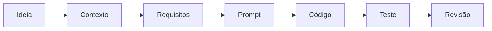

# Do Zero ao Projeto — Engenharia de Prompts na Prática

**Tech Metro · Rota A — Campus Events: da ideia à aplicação web**

Materiais didáticos gratuitos da oficina **Do Zero ao Projeto**, com guia de estudo, biblioteca de prompts, slides e uma demonstração web funcional. O fio condutor é o **Campus Events**, uma página simples para estudantes encontrarem eventos do campus, construída passo a passo com o apoio de ferramentas de IA generativa.

> **Ideia central:** um bom prompt funciona como uma especificação. A IA pode acelerar a execução; entender o problema, definir o que é “pronto” e testar o resultado continua sendo responsabilidade de quem desenvolve.

## Sumário

- [Evento e equipe](#evento-e-equipe)
- [Objetivos de aprendizagem](#objetivos-de-aprendizagem)
- [Conteúdo abordado](#conteúdo-abordado)
- [Demonstração: Campus Events](#demonstração-campus-events)
- [Acesso aos materiais](#acesso-aos-materiais)
- [Como executar localmente](#como-executar-localmente)
- [Como utilizar os prompts](#como-utilizar-os-prompts)
- [Atividades recomendadas](#atividades-recomendadas)
- [Aviso sobre eventos fictícios](#aviso-sobre-eventos-fictícios)
- [Autoria e distribuição](#autoria-e-distribuição)

## Evento e equipe

| | |
| --- | --- |
| **Instituição** | Centro Universitário Fametro — Unifametro |
| **Evento** | Tech Metro — Projeto de Extensão |
| **Oficina** | Do Zero ao Projeto — Engenharia de Prompts na Prática |
| **Rota** | A — Campus Events: da ideia à aplicação web |
| **Mediação** | Levi Celestino Azevedo Pereira |
| **Equipe de apoio** | Ariel Barbosa e Josué Silva |
| **Público** | Estudantes de graduação, principalmente de Análise e Desenvolvimento de Sistemas (ADS) |
| **Formato** | Oficina presencial de 30 minutos + estudo autônomo com este material |

## Objetivos de aprendizagem

Ao estudar este material, você deverá ser capaz de:

1. Explicar o que é um prompt e o que é engenharia de prompts.
2. Diferenciar uma instrução vaga de uma instrução estruturada.
3. Escrever prompts com o método **P.A.C.T.O.** (Persona, Ação, Contexto & Estilo, Tom, Output).
4. Organizar instruções com **Markdown** (hierarquia) e **XML** (delimitação de blocos).
5. Distinguir **zero-shot** de **few-shot** e escolher a abordagem adequada.
6. Pedir planos verificáveis, revisões críticas e respostas avaliadas contra **critérios de sucesso**.
7. Diferenciar requisitos funcionais, requisitos não funcionais e restrições de projeto.
8. Reproduzir o fluxo de criação do Campus Events e avaliar criticamente o código gerado.

## Conteúdo abordado



| Capítulo do guia | Tema |
| --- | --- |
| 1 | Introdução à engenharia de prompts |
| 2 | Método P.A.C.T.O. (modelo didático adotado pela equipe da oficina) |
| 3 | Organizando instruções com Markdown e XML (e uma nota sobre JSON) |
| 4 | Zero-shot e few-shot |
| 5 | Planejamento (*Reasoning Process*), autocrítica (*Self-Criticism Task*) e critérios de sucesso (*Success Criteria*) |
| 6 | Projeto Campus Events: requisitos, prompt principal, HTML/CSS/JavaScript, testes e refinamento |
| 7 | Atividades práticas com dificuldade progressiva |
| 8 | Boas práticas e limitações: alucinações, privacidade, segurança e uso ético |

## Demonstração: Campus Events

O arquivo [`index.html`](index.html) é a versão de referência do aplicativo. Ele reúne HTML, CSS e JavaScript em um único arquivo, sem bibliotecas, sem servidor e sem acesso à internet.

**Funcionalidades:**

- Lista de seis eventos fictícios em cards (categoria, título, data, horário, local e descrição).
- Busca por título, local ou descrição, ignorando acentos e maiúsculas (por exemplo, “logica” encontra “Maratona de Lógica”).
- Filtro por categoria, combinado com a busca.
- Contador acessível de eventos exibidos.
- Mensagem quando nenhum evento é encontrado, com botão **Limpar filtros**.
- Layout responsivo e navegação por teclado.

**Demonstração online (GitHub Pages):** <https://levsbr.github.io/techmetro-oficina-ia/>

> [!IMPORTANT]
> **Endereço previsto — publicação pendente.** O link acima só funcionará depois que o repositório for publicado e o GitHub Pages for ativado. Enquanto isso, use a execução local, descrita abaixo.

## Acesso aos materiais

| Arquivo | Conteúdo |
| --- | --- |
| [`index.html`](index.html) | Demonstração Campus Events (versão de referência). |
| [`prompts/TechMetro_Prompts.md`](prompts/TechMetro_Prompts.md) | Biblioteca de prompts P0 a P7 e prompts reserva, prontos para copiar. |
| [`materiais/TechMetro_Guia_do_Participante.md`](materiais/TechMetro_Guia_do_Participante.md) | Guia do Participante para leitura direta no GitHub. |
| [`materiais/TechMetro_Guia_do_Participante.pdf`](materiais/TechMetro_Guia_do_Participante.pdf) | Guia do Participante para leitura ou impressão (A4). |
| [`materiais/TechMetro_Guia_do_Participante.docx`](materiais/TechMetro_Guia_do_Participante.docx) | Guia do Participante em formato editável (Word). |
| [`materiais/TechMetro_Slides.pdf`](materiais/TechMetro_Slides.pdf) | Slides da apresentação. |

```text
techmetro-oficina-ia/
├── README.md
├── index.html
├── prompts/
│   └── TechMetro_Prompts.md
└── materiais/
    ├── TechMetro_Slides.pdf
    ├── TechMetro_Guia_do_Participante.pdf
    ├── TechMetro_Guia_do_Participante.docx
    └── TechMetro_Guia_do_Participante.md
```

**Endereço do repositório:** <https://github.com/LevsBr/techmetro-oficina-ia> *(endereço previsto — publicação pendente)*

## Como executar localmente

1. Baixe o repositório: botão verde **Code** → **Download ZIP**, e extraia o arquivo. Se preferir usar Git:

   ```bash
   git clone https://github.com/LevsBr/techmetro-oficina-ia.git
   ```

2. Abra a pasta `techmetro-oficina-ia` e dê **duplo clique** em `index.html`. A página abre no navegador padrão, sem internet, servidor ou instalação.
3. Para simular um celular, pressione **F12**, ative o modo dispositivo (**Ctrl + Shift + M**) e escolha uma largura de cerca de 390 px.
4. Para estudar o código, abra `index.html` em um editor de texto (por exemplo, VS Code).

**Teste rápido** (critérios de sucesso do prompt P5):

- [ ] A página abre com duplo clique e exibe 6 cards.
- [ ] Buscar `logica` (sem acento) mostra somente “Maratona de Lógica”.
- [ ] Buscar `robótica` mostra “Nenhum evento encontrado”.
- [ ] Em 390 px de largura não há rolagem horizontal.
- [ ] Com a tecla **Tab** é possível chegar ao campo de busca, com o foco visível.

## Como utilizar os prompts

1. Abra a [biblioteca de prompts](prompts/TechMetro_Prompts.md) e escolha um prompt (P0 a P7).
2. Copie o conteúdo do bloco de código e cole em uma ferramenta de IA de texto (por exemplo, Claude, ChatGPT ou Gemini). Use uma conversa nova para cada experimento.
3. Siga a sequência da oficina:

   | Prompt | Objetivo |
   | --- | --- |
   | P0 | Ver por que um pedido vago falha. |
   | P1 | Levantar requisitos antes de pedir código. |
   | P2 | Prompt principal com P.A.C.T.O., Markdown e XML. |
   | P3 | Few-shot: gerar dados no mesmo formato dos exemplos. |
   | P4 | Pedir um plano de implementação verificável. |
   | P5 | Conferir a entrega contra critérios objetivos. |
   | P6 | Pedir uma revisão crítica e a versão corrigida. |
   | P7 | Pedir uma melhoria sem quebrar o que já funciona. |

4. Se a resposta trouxer código, salve-o como `.html` e **teste no navegador**. Uma resposta da IA dizendo que “funciona” não é evidência.

> [!NOTE]
> As respostas variam entre ferramentas e até entre execuções da mesma ferramenta. Isso é esperado: o objetivo é aprender a especificar e a verificar, não obter sempre o mesmo texto.

## Atividades recomendadas

O capítulo 7 do [Guia do Participante](materiais/TechMetro_Guia_do_Participante.md) traz cinco atividades, com objetivo, instruções, resultado esperado e perguntas de reflexão:

1. **Diagnóstico de prompts:** melhorar um prompt vago.
2. **Aplicando o P.A.C.T.O.:** escrever um prompt estruturado para uma nova funcionalidade.
3. **Definindo critérios de sucesso:** criar uma lista de verificação testável.
4. **Refinando o aplicativo:** pedir uma melhoria no Campus Events e testar de novo.
5. **Comparando resultados entre IAs:** executar o mesmo prompt em duas ferramentas e comparar.

## Aviso sobre eventos fictícios

> [!WARNING]
> Todos os eventos exibidos no Campus Events e citados nos materiais são **fictícios**. Eles **não** representam a programação oficial da Unifametro nem de qualquer outra instituição. O aplicativo é um **protótipo didático**: não tem cadastro, login, banco de dados nem coleta de informações pessoais.

## Autoria e distribuição

- **Autoria:** equipe da Rota A do Tech Metro: Levi Celestino Azevedo Pereira (mediação), Ariel Barbosa e Josué Silva (apoio).
- **Instituição:** Centro Universitário Fametro — Unifametro, no âmbito do projeto de extensão Tech Metro.
- **Distribuição:** gratuita, para fins educacionais.
- **Licença:** ainda não definida pela equipe. Até que uma licença seja publicada neste repositório, consulte a equipe antes de reutilizar ou adaptar o material.
- **Uso de IA:** os materiais foram produzidos com apoio de ferramentas de IA generativa e revisados pela equipe. Sempre verifique as informações e teste os códigos antes de usá-los.
