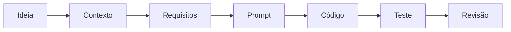
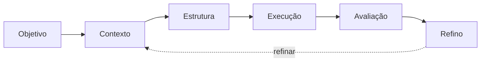
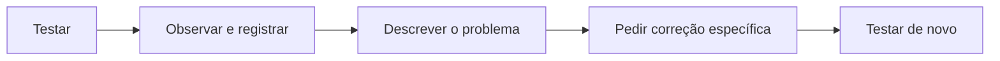

# Do Zero ao Projeto — Guia do Participante

**Engenharia de Prompts na Prática** · Rota A — Campus Events: da ideia à aplicação web

> **Tech Metro — Projeto de Extensão** · Centro Universitário Fametro — Unifametro  
> **Mediação:** Levi Celestino Azevedo Pereira · **Equipe de apoio:** Ariel Barbosa e Josué Silva  
> Versão 2.1 — outubro de 2026 · Distribuição gratuita



> Outras versões deste guia: [PDF para leitura e impressão](TechMetro_Guia_do_Participante.pdf) · [Word editável](TechMetro_Guia_do_Participante.docx)  
> Materiais relacionados: [Biblioteca de prompts](../prompts/TechMetro_Prompts.md) · [Slides](TechMetro_Slides.pdf) · [Demonstração Campus Events](../index.html) · [Página inicial do repositório](../README.md)

---

## Apresentação

Este guia acompanha a oficina **Do Zero ao Projeto — Engenharia de Prompts na Prática**, realizada no Tech Metro, projeto de extensão da Unifametro. A oficina presencial dura cerca de 30 minutos; este material foi escrito para que você possa revisar tudo depois, no seu ritmo, e reproduzir cada etapa mesmo que não tenha assistido à apresentação.

O fio condutor é um projeto pequeno e concreto: o **Campus Events**, uma página web para estudantes encontrarem eventos do campus. Partindo de uma ideia vaga (“faz um site de eventos da faculdade”), você verá como transformá-la em requisitos, escrever uma instrução clara para uma ferramenta de IA, testar o código recebido e pedir melhorias de forma objetiva.

A mensagem central é simples: **um bom prompt funciona como uma especificação**. A IA pode acelerar a execução, mas entender o problema, definir o que é “pronto” e verificar o resultado continua sendo responsabilidade de quem desenvolve.

> [!NOTE]
> **Nota — Sobre os dados usados**
>
> Todos os eventos citados neste guia e no protótipo são **fictícios**. Eles não representam a programação oficial da Unifametro.

### Objetivos de aprendizagem

Ao concluir o estudo deste material, você deverá ser capaz de:

1. Explicar o que é um prompt e o que é engenharia de prompts.
2. Diferenciar uma instrução vaga de uma instrução estruturada e justificar por que a segunda tende a gerar resultados mais úteis.
3. Escrever prompts usando o método **P.A.C.T.O.** (Persona, Ação, Contexto & Estilo, Tom, Output).
4. Organizar instruções com **Markdown** (hierarquia) e **XML** (delimitação de blocos).
5. Distinguir as abordagens **zero-shot** e **few-shot** e escolher a mais adequada para uma tarefa.
6. Solicitar planos de solução verificáveis, revisões críticas e respostas avaliadas contra **critérios de sucesso** objetivos.
7. Diferenciar requisitos funcionais de não funcionais e escrever critérios de aceitação testáveis.
8. Reproduzir o fluxo **Ideia → Contexto → Requisitos → Prompt → Código → Teste → Revisão** no projeto Campus Events.
9. Avaliar criticamente respostas e códigos gerados por IA, considerando erros, segurança, privacidade e ética acadêmica.

### Como usar este guia

- **Leia em ordem.** Os capítulos 1 a 5 apresentam os conceitos; o capítulo 6 os aplica no Campus Events; o capítulo 7 traz atividades para praticar; o capítulo 8 discute limites e responsabilidades.
- **Tenha uma ferramenta de IA aberta.** Os prompts podem ser copiados e colados em qualquer assistente de texto (por exemplo, Claude, ChatGPT ou Gemini). As respostas variam entre ferramentas e até entre execuções; isso é esperado.
- **Teste no navegador.** Sempre que houver código, abra o arquivo e confira os critérios de sucesso. Um texto da IA dizendo que “funciona” não é evidência.
- **Use os quadros como atalhos.** Eles destacam definições, alertas e dicas práticas (veja a legenda abaixo).
- **Consulte o glossário** ao encontrar um termo desconhecido; ele está no final do guia.

| Quadro | Para que serve |
| --- | --- |
| **Definição** | Conceito-chave apresentado de forma curta e precisa. |
| **Nota** | Informação complementar ou esclarecimento. |
| **Dica** | Sugestão prática para aplicar o conteúdo. |
| **Atenção** | Erro comum, limitação ou cuidado de segurança. |
| **Prompt Pn** | Instrução pronta para copiar, numerada como na biblioteca de prompts da oficina (P0 a P7). |
| **Trecho didático** | Código curto para estudo, proposto para verificação pelo participante. O guia indica o que você deve conferir. |

---

## Sumário

- [Apresentação](#apresentação)
  - [Objetivos de aprendizagem](#objetivos-de-aprendizagem)
  - [Como usar este guia](#como-usar-este-guia)
- [1. Introdução à Engenharia de Prompts](#1-introdução-à-engenharia-de-prompts)
  - [1.1 O que é um prompt](#11-o-que-é-um-prompt)
  - [1.2 O que é engenharia de prompts](#12-o-que-é-engenharia-de-prompts)
  - [1.3 Por que a clareza importa](#13-por-que-a-clareza-importa)
  - [1.4 Como contexto, restrições e formato influenciam o resultado](#14-como-contexto-restrições-e-formato-influenciam-o-resultado)
  - [1.5 Prompt genérico × prompt estruturado](#15-prompt-genérico--prompt-estruturado)
  - [1.6 O processo de engenharia de prompts](#16-o-processo-de-engenharia-de-prompts)
- [2. O Método P.A.C.T.O.](#2-o-método-pacto)
  - [2.1 P — Persona / Papel](#21-p--persona--papel)
  - [2.2 A — Ação / Tarefa](#22-a--ação--tarefa)
  - [2.3 C — Contexto & Estilo](#23-c--contexto--estilo)
  - [2.4 T — Tom / Atmosfera](#24-t--tom--atmosfera)
  - [2.5 O — Output / Formato de saída](#25-o--output--formato-de-saída)
  - [2.6 Checklist rápido antes de enviar](#26-checklist-rápido-antes-de-enviar)
- [3. Organizando Instruções com Markdown e XML](#3-organizando-instruções-com-markdown-e-xml)
  - [3.1 O que é Markdown](#31-o-que-é-markdown)
  - [3.2 Estruturando um prompt com Markdown](#32-estruturando-um-prompt-com-markdown)
  - [3.3 O que é XML](#33-o-que-é-xml)
  - [3.4 Markdown e XML juntos](#34-markdown-e-xml-juntos)
  - [3.5 E o JSON?](#35-e-o-json)
  - [3.6 Quando usar cada formato](#36-quando-usar-cada-formato)
- [4. Zero-shot e Few-shot](#4-zero-shot-e-few-shot)
  - [4.1 Definições](#41-definições)
  - [4.2 Exemplo 1 — classificando requisitos](#42-exemplo-1--classificando-requisitos)
  - [4.3 Exemplo 2 — gerando dados no mesmo formato](#43-exemplo-2--gerando-dados-no-mesmo-formato)
  - [4.4 Quadro comparativo](#44-quadro-comparativo)
  - [4.5 Atividade rápida](#45-atividade-rápida)
- [5. Planejamento, Autocrítica e Critérios de Sucesso](#5-planejamento-autocrítica-e-critérios-de-sucesso)
  - [5.1 Reasoning Process: pedindo um plano de solução](#51-reasoning-process-pedindo-um-plano-de-solução)
  - [5.2 Self-Criticism Task: pedindo uma revisão crítica](#52-self-criticism-task-pedindo-uma-revisão-crítica)
  - [5.3 Success Criteria: definindo o que é “pronto”](#53-success-criteria-definindo-o-que-é-pronto)
  - [5.4 Checklist prático de validação](#54-checklist-prático-de-validação)
- [6. Projeto Campus Events](#6-projeto-campus-events)
  - [6.1 O problema e o público-alvo](#61-o-problema-e-o-público-alvo)
  - [6.2 Mapa do processo: etapas, prompts e entregas](#62-mapa-do-processo-etapas-prompts-e-entregas)
  - [6.3 Levantando requisitos com a IA](#63-levantando-requisitos-com-a-ia)
  - [6.4 O prompt principal](#64-o-prompt-principal)
  - [6.5 O papel do HTML, do CSS e do JavaScript](#65-o-papel-do-html-do-css-e-do-javascript)
  - [6.6 Abrindo o protótipo no navegador](#66-abrindo-o-protótipo-no-navegador)
  - [6.7 Testando e refinando](#67-testando-e-refinando)
  - [6.8 Pedindo melhorias com prompts](#68-pedindo-melhorias-com-prompts)
- [7. Atividades Práticas](#7-atividades-práticas)
  - [Atividade 1 — Diagnóstico de prompts](#atividade-1--diagnóstico-de-prompts)
  - [Atividade 2 — Aplicando o P.A.C.T.O.](#atividade-2--aplicando-o-pacto)
  - [Atividade 3 — Definindo critérios de sucesso](#atividade-3--definindo-critérios-de-sucesso)
  - [Atividade 4 — Refinando o aplicativo](#atividade-4--refinando-o-aplicativo)
  - [Atividade 5 — Comparando resultados entre IAs](#atividade-5--comparando-resultados-entre-ias)
- [8. Boas Práticas e Limitações](#8-boas-práticas-e-limitações)
  - [8.1 Verifique as respostas](#81-verifique-as-respostas)
  - [8.2 Erros e alucinações](#82-erros-e-alucinações)
  - [8.3 Privacidade e dados pessoais](#83-privacidade-e-dados-pessoais)
  - [8.4 Segurança do código gerado](#84-segurança-do-código-gerado)
  - [8.5 A importância dos testes](#85-a-importância-dos-testes)
  - [8.6 Responsabilidade humana](#86-responsabilidade-humana)
  - [8.7 Uso ético e acadêmico](#87-uso-ético-e-acadêmico)
- [Glossário](#glossário)
- [Checklist Geral de Aprendizagem](#checklist-geral-de-aprendizagem)
- [Referências e Leituras Complementares](#referências-e-leituras-complementares)
- [Onde Encontrar o Material da Oficina](#onde-encontrar-o-material-da-oficina)

---

## 1. Introdução à Engenharia de Prompts

Ferramentas de IA generativa de texto, como os grandes modelos de linguagem (LLMs), respondem a instruções escritas em linguagem natural. A qualidade da resposta depende muito da qualidade dessa instrução. Este capítulo apresenta os conceitos básicos e mostra, com um exemplo do Campus Events, por que clareza faz diferença.

### 1.1 O que é um prompt

> [!NOTE]
> **Definição — Prompt**
>
> É a instrução, pergunta ou conjunto de informações que você envia a um modelo de IA para obter uma resposta. Pode conter a tarefa, o contexto, exemplos, restrições e o formato desejado da saída.

Um prompt pode ser uma frase curta (“Explique o que é HTML”) ou um documento organizado em seções. Não existe tamanho ideal: existe a informação necessária para que a tarefa seja executada sem adivinhação.

### 1.2 O que é engenharia de prompts

> [!NOTE]
> **Definição — Engenharia de prompts**
>
> É a prática de projetar, testar e refinar instruções para modelos de linguagem, de modo que as respostas sejam úteis, previsíveis e verificáveis. Envolve definir papel, tarefa, contexto, restrições, exemplos e formato de saída — e iterar com base nos resultados.

A palavra “engenharia” não está ali por acaso. Assim como em um projeto de software, há um objetivo, requisitos, uma solução proposta, testes e revisões. O prompt raramente fica bom na primeira tentativa: ele é ajustado a partir do que se observa na resposta.

### 1.3 Por que a clareza importa

Modelos de linguagem geram texto a partir de padrões aprendidos em grandes volumes de dados. Quando a instrução é ambígua, o modelo **preenche as lacunas com escolhas prováveis**, que nem sempre coincidem com a sua intenção. Por isso, o mesmo pedido vago pode produzir resultados muito diferentes a cada tentativa.

Observe a ideia inicial da oficina:

**Prompt P0 — Prompt vago (demonstração do erro)**

```text
Faz um site de eventos da faculdade.
```

Para atender a esse pedido, a IA precisa adivinhar, entre outras coisas:

| Pergunta não respondida | Por que importa |
| --- | --- |
| Quem vai usar? | Define linguagem, prioridades e dispositivos (celular, notebook). |
| Quais dados cada evento tem? | Sem campos definidos, cada resposta inventa uma estrutura diferente. |
| Precisa de busca ou filtros? | Funcionalidades não pedidas tendem a não aparecer — ou a aparecer de forma inesperada. |
| Qual tecnologia e quantos arquivos? | Pode vir um projeto com framework, servidor e dependências que você não sabe executar. |
| Deve funcionar no celular? | Responsividade e acessibilidade raramente surgem sem serem pedidas. |
| Como saber se está pronto? | Sem critério, “ficou bom” é apenas opinião. |

### 1.4 Como contexto, restrições e formato influenciam o resultado

Três tipos de informação reduzem a ambiguidade de forma especialmente eficaz:

- **Contexto** — para quem é a solução, em que cenário será usada e com quais dados. Exemplo: “público: estudantes universitários, acessando pelo celular e pelo notebook”.
- **Restrições** — o que é obrigatório ou proibido. Exemplo: “um único arquivo .html, sem bibliotecas, frameworks, CDN ou servidor”.
- **Formato de saída** — como a resposta deve ser entregue. Exemplo: “apenas o código completo em um bloco, seguido de uma lista curta explicando como testar”.

Quanto mais claras essas informações, menor o espaço para escolhas arbitrárias e mais fácil fica avaliar se a resposta atende ao que foi pedido.

### 1.5 Prompt genérico × prompt estruturado

**❌ Prompt vago** — *A IA adivinha*

```text
Faz um site de eventos
da faculdade.
```

Resultado genérico, diferente a cada tentativa e difícil de testar. Não há público, dados, tecnologia, formato de entrega nem critério de pronto.

**✅ Prompt estruturado** — *A IA executa*

```text
Atue como desenvolvedor front-end.
Crie o app Campus Events:
- cards de eventos + busca
- responsivo e acessível
- 1 arquivo HTML, sem dependências
- eventos fictícios
```

Resultado mais específico e verificável: cada linha vira algo que você pode conferir no navegador.

*Figura 1.1 — Comparativo entre prompt vago e prompt estruturado.*

Uma versão mais completa do prompt estruturado, usada como exemplo no guia original da oficina, é esta:

**Exemplo — prompt estruturado em texto corrido**

```text
Atue como desenvolvedor web com atenção à acessibilidade.
Crie uma página de eventos acadêmicos para estudantes universitários.
Inclua cards com nome, data, horário e local, além de busca por título.
Entregue HTML, CSS e JavaScript em um único arquivo index.html,
sem dependências externas. Use eventos fictícios e layout responsivo.
Ao final, apresente um checklist dos requisitos atendidos e dos
que ainda precisam ser testados no navegador.
```

> [!WARNING]
> **Atenção — Ideia central**
>
> Um prompt melhor **não garante** um resultado perfeito. Ele diminui ambiguidades e torna o resultado mais fácil de avaliar — e a avaliação continua sendo sua.

### 1.6 O processo de engenharia de prompts

Na prática, escrever um bom prompt é um ciclo. Você define o objetivo, fornece contexto, estrutura a instrução, executa, avalia a resposta contra critérios claros e refina o que for necessário.



*Figura 1.2 — Ciclo de engenharia de prompts.*

↺ Se a avaliação apontar falhas, volte ao contexto ou à estrutura e ajuste o prompt.

| Etapa | Pergunta-guia |
| --- | --- |
| Objetivo | O que exatamente eu quero obter? Para quê? |
| Contexto | Que informações a IA precisa para não adivinhar (público, dados, cenário)? |
| Estrutura | Minha instrução está organizada (P.A.C.T.O., Markdown, XML)? Há exemplos, se necessário? |
| Execução | Enviei o prompt e salvei a resposta para análise? |
| Avaliação | A resposta atende a cada critério de sucesso? O que eu testei de verdade? |
| Refino | Qual ajuste específico vai corrigir o problema observado? |

---

## 2. O Método P.A.C.T.O.

Para não esquecer os componentes de uma boa instrução, a equipe da oficina adota um roteiro mnemônico de cinco letras: **P.A.C.T.O.** Cada letra corresponde a uma pergunta que o seu prompt deve responder.

> [!NOTE]
> **Nota — Origem do método**
>
> O P.A.C.T.O. é o **modelo didático adotado pela equipe da Rota A** nesta oficina. Ele não é uma sintaxe obrigatória das ferramentas de IA nem um padrão formal da área: é um checklist para ajudar você a lembrar o que incluir.

| Letra | Elemento | Pergunta orientadora | Exemplo no Campus Events |
| --- | --- | --- | --- |
| **P** | Persona / Papel | Quem a IA deve ser? | Dev front-end sênior especializado em acessibilidade |
| **A** | Ação / Tarefa | O que deve produzir? | Criar o aplicativo Campus Events |
| **C** | Contexto & Estilo | Para quem, com quais dados, requisitos e restrições? | Estudantes; 6 eventos fictícios; busca; 1 arquivo .html |
| **T** | Tom / Atmosfera | Qual atmosfera visual ou de linguagem? | Moderno, fundo escuro, azul, ciano e roxo |
| **O** | Output / Formato de saída | Em que formato entregar? | Código completo em 1 bloco + como testar |

*Figura 2.1 — Os cinco elementos do método P.A.C.T.O. aplicados ao Campus Events.*

### 2.1 P — Persona / Papel

Indica **qual função a IA deve assumir**. A persona orienta o vocabulário, o nível de detalhe e as prioridades da resposta. Um “analista de requisitos” tende a fazer perguntas e listar necessidades; um “desenvolvedor front-end sênior especializado em acessibilidade” tende a priorizar código semântico e navegação por teclado.

**Exemplo no Campus Events**

```text
Atue como desenvolvedor front-end sênior especializado em acessibilidade.
```

### 2.2 A — Ação / Tarefa

Descreve **o que deve ser produzido**, com um verbo claro: criar, listar, revisar, classificar, explicar, corrigir. Uma boa ação é específica o suficiente para que você saiba reconhecer quando ela foi cumprida.

**Exemplo no Campus Events**

```text
Crie o aplicativo web "Campus Events" para divulgação de eventos universitários.
```

### 2.3 C — Contexto & Estilo

Reúne **para quem, em que cenário, com quais dados, requisitos e restrições** a tarefa deve ser feita. É o elemento mais extenso e, em geral, o mais importante: é nele que mora a maior parte da ambiguidade de um pedido.

**Exemplo no Campus Events (resumo)**

```text
Público: estudantes universitários, acessando pelo celular e pelo notebook.
Use somente eventos FICTÍCIOS (6 eventos), com: título, categoria, data,
horário, local e descrição. Categorias: Workshop, Palestra, Competição.
Requisitos: cards, busca por título/local/descrição, mensagem quando nada
for encontrado, layout responsivo, acessibilidade básica.
Restrições: um único arquivo .html, sem bibliotecas, CDN ou servidor.
```

### 2.4 T — Tom / Atmosfera

Define o **estilo visual ou de linguagem** esperado. Em um texto, pode ser “formal”, “didático para calouros”, “objetivo”. Em uma interface, pode descrever a identidade visual. Em código, pode incluir convenções, como comentários em português.

**Exemplo no Campus Events**

```text
Visual moderno e tecnológico: fundo escuro, detalhes em azul, ciano e roxo.
Código limpo e comentado em português.
```

### 2.5 O — Output / Formato de saída

Especifica **como a resposta deve ser entregue**: um bloco de código, uma tabela, uma lista numerada, um número máximo de itens. Um formato bem definido facilita copiar, comparar e testar o resultado.

**Exemplo no Campus Events**

```text
Entregue apenas o código completo do arquivo em um bloco de código,
seguido de uma lista curta (máx. 5 itens) explicando como testar.
```

### 2.6 Checklist rápido antes de enviar

- [ ] **P** — Defini qual papel a IA deve assumir?
- [ ] **A** — A tarefa tem um verbo claro e um resultado reconhecível?
- [ ] **C** — Informei público, dados, requisitos e restrições?
- [ ] **T** — Descrevi o estilo visual ou de linguagem esperado?
- [ ] **O** — Especifiquei o formato e o tamanho da resposta?

> [!TIP]
> **Dica — Qual letra você costuma esquecer?**
>
> Na maioria dos pedidos do dia a dia, as letras esquecidas são **C** (contexto e restrições) e **O** (formato da saída). Revise essas duas com atenção especial.

---

## 3. Organizando Instruções com Markdown e XML

Um prompt longo pode ficar confuso tanto para você quanto para a IA. Dois recursos ajudam a organizá-lo: **Markdown**, que deixa a hierarquia visível, e **XML**, que marca onde cada bloco de informação começa e termina.

> [!WARNING]
> **Atenção — Organização não é garantia**
>
> Markdown e XML **não garantem** que a IA obedecerá às instruções. São recursos de organização e delimitação que reduzem ambiguidades e facilitam a revisão do prompt. A verificação da resposta continua necessária.

### 3.1 O que é Markdown

> [!NOTE]
> **Definição — Markdown**
>
> Linguagem de marcação leve que usa símbolos simples para indicar a estrutura de um texto. É muito usada em arquivos README, documentação técnica, plataformas como o GitHub e nas próprias respostas de assistentes de IA. A especificação CommonMark padroniza sua sintaxe.

| Elemento | Sintaxe | Uso no prompt |
| --- | --- | --- |
| Título | `# Título`, `## Subtítulo` | Separar as seções (por exemplo, uma para cada letra do P.A.C.T.O.). |
| Lista | `- item` ou `1. item` | Enumerar requisitos, restrições e critérios. |
| Negrito | `**texto**` | Destacar algo essencial, com moderação. |
| Código em linha | uma crase antes e outra depois do termo | Indicar nomes técnicos exatos, como `textContent`. |
| Bloco de código | três crases antes e depois | Isolar código, dados ou exemplos de saída. |

### 3.2 Estruturando um prompt com Markdown

**Exemplo — prompt organizado com Markdown**

```markdown
# Objetivo
Criar a agenda Campus Events.

## Requisitos
- Busca por nome do evento
- Layout responsivo
- Eventos fictícios

## Saída
Entregue um único arquivo HTML.
```

Os títulos permitem que você revise o prompt por partes e que a IA identifique a função de cada trecho. No Campus Events, usamos um título para cada letra do P.A.C.T.O. (veja o prompt P2 no capítulo 6).

### 3.3 O que é XML

> [!NOTE]
> **Definição — XML (eXtensible Markup Language)**
>
> Linguagem de marcação definida pelo W3C que organiza informações entre **tags** de abertura e fechamento, como `<contexto>` e `</contexto>`. Em programação, é usada para troca e armazenamento de dados. Em prompts, as tags funcionam como **delimitadores**: etiquetas que indicam o que é contexto, o que é instrução e o que é exemplo.

**Exemplo — delimitando partes do prompt com tags**

```xml
<contexto>
Página universitária para divulgação de eventos fictícios.
</contexto>

<tarefa>
Liste até seis requisitos funcionais.
</tarefa>

<restricoes>
Não invente integrações nem eventos oficiais.
</restricoes>
```

Pense nas tags como **caixas com etiqueta**: tudo o que está entre `<contexto>` e `</contexto>` é contexto; tudo o que está entre `<restricoes>` e `</restricoes>` é regra. Isso é especialmente útil quando você cola textos longos — um documento de requisitos, um trecho de código, uma mensagem de erro —, porque fica claro onde o material começa e termina.

#### Boas práticas com tags em prompts

- Use nomes descritivos e consistentes (`<contexto>`, `<requisitos>`, `<restricoes>`, `<exemplos>`).
- Sempre feche cada tag que abrir e não cruze tags (abrir A, abrir B, fechar A, fechar B).
- Prefira nomes sem acentos e sem espaços; isso segue as convenções usuais de XML e evita confusão.
- Faça referência às tags na instrução: “Use apenas os dados dentro de `<contexto>`”.

> [!NOTE]
> **Nota — As tags não executam nada**
>
> Tags em um prompt são texto delimitador: não executam código nem ativam funções especiais da ferramenta. O prompt não precisa ser um documento XML formalmente válido; o importante é que a delimitação seja clara e consistente.

### 3.4 Markdown e XML juntos

Os dois recursos se complementam: o Markdown organiza a **hierarquia** (seções), e o XML **delimita** blocos de informação dentro dessas seções.

**Trecho do prompt P2 — combinação de Markdown e XML**

```text
# C — Contexto & Estilo
<contexto>
Público: estudantes universitários, acessando pelo celular e pelo notebook.
Use somente eventos FICTÍCIOS (6 eventos).
</contexto>

<restricoes>
- HTML, CSS e JavaScript em UM ÚNICO arquivo .html.
- Sem bibliotecas, frameworks, CDN ou servidor.
</restricoes>
```

### 3.5 E o JSON?

JSON (*JavaScript Object Notation*) não é um recurso de organização de prompts, mas aparece com frequência ao trabalhar com IA e com web: é um formato para **representar dados estruturados**, muito usado em APIs e automações. Você pode pedir que a IA responda em JSON quando quiser processar a resposta com um programa.

**Exemplo — um evento representado em JSON válido**

```json
{
  "titulo": "Oficina de HTML",
  "local": "Laboratório 3",
  "data": "2026-10-20",
  "vagas": 30
}
```

- Os nomes das propriedades ficam **entre aspas duplas**.
- Textos usam aspas duplas; números (`30`) e valores lógicos (`true`, `false`) não usam aspas.
- Não há vírgula depois do último item nem comentários dentro do JSON.

### 3.6 Quando usar cada formato

| Formato | Função principal | Use quando… |
| --- | --- | --- |
| Markdown | Organizar e hierarquizar | O prompt tem várias seções ou você quer uma resposta legível, com títulos e listas. |
| XML (tags) | Delimitar blocos | Você precisa separar contexto, instruções, exemplos ou textos colados de fontes externas. |
| JSON | Representar dados | A resposta será lida por um programa ou precisa seguir campos e tipos fixos. |

---

## 4. Zero-shot e Few-shot

Uma decisão importante ao escrever um prompt é se você vai ou não **mostrar exemplos** do resultado esperado. Essa escolha define duas abordagens clássicas, descritas na literatura sobre modelos de linguagem.

### 4.1 Definições

> [!NOTE]
> **Definição — Zero-shot**
>
> Pedir a tarefa **sem fornecer exemplos** de entrada e saída. O modelo se baseia apenas na instrução. É rápido de escrever, mas o formato e os critérios ficam a cargo da IA.

> [!NOTE]
> **Definição — Few-shot**
>
> Fornecer **alguns exemplos** (geralmente de dois a cinco) de entrada e saída antes do novo caso. O modelo tende a imitar o padrão mostrado: formato, campos, tamanho e estilo.

### 4.2 Exemplo 1 — classificando requisitos

Considere a tarefa de classificar requisitos do Campus Events como funcionais ou não funcionais (esses conceitos são detalhados no capítulo 6).

**❌ Zero-shot** — *Só a instrução*

```text
Classifique este requisito como funcional
ou não funcional:
"A página deve funcionar em telas de
celular".
Explique em uma frase.
```

A IA decide o formato da resposta: pode vir um parágrafo, uma lista ou uma explicação longa.

**✅ Few-shot** — *Instrução + exemplos*

```text
Classifique o requisito e responda no
formato "tipo — justificativa".
Exemplo 1: "Permitir buscar eventos por
nome" → Funcional — define uma ação.
Exemplo 2: "Abrir bem em dispositivos
móveis" → Não funcional — define qualidade.
Agora classifique: "Exibir uma mensagem
quando não houver resultados".
```

Os exemplos fixam o formato. Resposta esperada: “Funcional — define um comportamento do sistema.”

*Figura 4.1 — Zero-shot × few-shot na classificação de requisitos.*

### 4.3 Exemplo 2 — gerando dados no mesmo formato

Na oficina, o few-shot foi usado para gerar novos eventos fictícios com a mesma estrutura dos já existentes:

**Prompt P3 — Few-shot: ensinando o formato do dado por exemplo**

```text
Gere mais 3 eventos fictícios seguindo EXATAMENTE o formato dos exemplos.

Exemplo 1:
{ titulo: "Introdução ao Python", categoria: "Workshop", data: "2026-11-03", hora: "19:00", local: "Laboratório 2", descricao: "Primeiros passos com variáveis, listas e laços em Python." }

Exemplo 2:
{ titulo: "Carreira em Tecnologia", categoria: "Palestra", data: "2026-11-05", hora: "10:00", local: "Auditório Central", descricao: "Como montar portfólio e se preparar para o primeiro estágio." }

Responda somente com os 3 objetos, um por linha.
```

**Comparação zero-shot:** “Gere 3 eventos para o site.” Nesse caso, a IA escolhe campos, formato e tamanho por conta própria — a resposta pode vir em tabela, em texto corrido ou com campos diferentes.

> [!NOTE]
> **Nota — Objeto JavaScript não é JSON**
>
> Os exemplos do P3 estão no formato de **objeto literal JavaScript** (nomes de propriedades sem aspas), que é o formato usado dentro do código do Campus Events. Eles **não são JSON válido**. Se você precisar de JSON — por exemplo, para salvar os eventos em um arquivo `.json` —, coloque os nomes das propriedades entre aspas duplas e peça explicitamente: “responda em JSON válido”.

**Variante — o Exemplo 1 do P3 em JSON válido**

```json
{"titulo": "Introdução ao Python", "categoria": "Workshop", "data": "2026-11-03", "hora": "19:00", "local": "Laboratório 2", "descricao": "Primeiros passos com variáveis, listas e laços em Python."}
```

### 4.4 Quadro comparativo

| Aspecto | Zero-shot | Few-shot |
| --- | --- | --- |
| O que o prompt contém | Apenas a instrução. | Instrução + exemplos de entrada e saída. |
| Esforço para escrever | Baixo. | Médio: é preciso preparar bons exemplos. |
| Controle do formato | Baixo: a IA decide. | Alto: a IA tende a imitar o padrão. |
| Tamanho do prompt | Menor. | Maior (cada exemplo ocupa espaço). |
| Riscos | Respostas inconsistentes entre tentativas. | Copiar detalhes indesejados dos exemplos ou generalizar a partir de poucos casos. |
| Quando usar | Tarefas simples e comuns, em que o formato não importa muito. | Quando formato, campos ou critérios precisam ser seguidos com consistência. |

> [!TIP]
> **Dica — Escolha bons exemplos**
>
> Exemplos devem ser corretos, variados e representativos. Se todos os exemplos forem da categoria “Workshop”, a IA pode supor que só existe essa categoria. E lembre-se: os exemplos orientam o formato, **mas não substituem a verificação** da resposta.

### 4.5 Atividade rápida

1. Escolha um sistema simples, por exemplo, o de uma biblioteca universitária.
2. Escreva cinco requisitos desse sistema, misturando funcionais e não funcionais.
3. Peça à IA que classifique os requisitos **sem exemplos** (zero-shot). Salve a resposta.
4. Em uma nova conversa, peça a mesma classificação com **dois exemplos** no formato “tipo — justificativa” (few-shot).
5. Compare: qual resposta seguiu um formato mais consistente? Alguma classificação ficou errada nas duas versões?

---

## 5. Planejamento, Autocrítica e Critérios de Sucesso

Três técnicas ajudam a tornar o trabalho com IA mais controlado e verificável: pedir um **plano** antes da execução (*Reasoning Process*), pedir uma **revisão crítica** da resposta (*Self-Criticism Task*) e definir com antecedência os **critérios de sucesso** (*Success Criteria*).

| Técnica | Nome em inglês | Como pedir |
| --- | --- | --- |
| **Plano** | *Reasoning Process* | Peça etapas numeradas, justificativa curta e como verificar cada uma. |
| **Autocrítica** | *Self-Criticism Task* | Peça uma revisão como revisor exigente — e a versão corrigida. |
| **Critérios** | *Success Criteria* | Defina o que é “pronto” em itens objetivos e testáveis. |

*Figura 5.1 — Três técnicas para controlar a qualidade da resposta.*

### 5.1 Reasoning Process: pedindo um plano de solução

Antes de pedir o código, você pode solicitar que a IA apresente um **plano de implementação**: as etapas do trabalho, uma justificativa curta para cada decisão e uma forma de verificar cada etapa. Isso permite corrigir o rumo antes de receber dezenas de linhas de código.

**Prompt P4 — Reasoning Process: plano de solução verificável**

```text
Antes de gerar o código do Campus Events, apresente um plano de implementação:
- de 4 a 6 etapas numeradas;
- para cada etapa, uma justificativa de no máximo uma linha;
- para cada etapa, como eu posso verificar que ela funcionou.
Não escreva código ainda.
```

Um bom plano para o Campus Events poderia incluir etapas como: estrutura HTML semântica, dados dos eventos, renderização dos cards, busca, mensagem de lista vazia e ajustes de responsividade. O que importa é que **cada etapa tenha uma verificação observável** (por exemplo: “buscar ‘logica’ deve exibir apenas a Maratona de Lógica”).

> [!WARNING]
> **Atenção — O plano é uma resposta, não o “pensamento” da IA**
>
> Ao pedir um plano, você obtém **um texto escrito pela IA**, e não acesso ao seu processo interno de raciocínio. Algumas ferramentas têm mecanismos internos de raciocínio que não são mostrados, ou mostram apenas resumos; e mesmo uma explicação detalhada pode não refletir com fidelidade como a resposta foi produzida. Trate o plano como qualquer outra resposta: **confira se faz sentido e se é verificável**.

### 5.2 Self-Criticism Task: pedindo uma revisão crítica

Depois de receber uma resposta, você pode pedir que a IA a revise criticamente: identifique falhas, omissões e riscos e proponha melhorias. A técnica funciona melhor quando você indica **o que deve ser examinado** e **como os problemas devem ser relatados**.

**Prompt P6 — Self-Criticism Task: autocrítica e correção**

```text
Revise criticamente o código que você gerou como se fosse um revisor de código exigente.
Liste até 5 problemas, cada um com: severidade (alta/média/baixa), onde está e como corrigir.
Considere: acessibilidade, responsividade, segurança (uso de innerHTML), legibilidade e requisitos não atendidos.
Depois, entregue o arquivo completo já corrigido.
```

Uma variação útil, presente no guia original, pede que a IA separe o que já foi confirmado do que ainda depende de teste:

**Variante — separando problemas confirmados de itens a testar**

```text
Revise criticamente a solução anterior. Liste possíveis falhas de
usabilidade, acessibilidade e funcionamento. Separe problemas
confirmados de itens que ainda dependem de teste manual.
```

> [!WARNING]
> **Atenção — A revisão da IA também precisa ser revisada**
>
> A autocrítica pode apontar problemas inexistentes, deixar de ver problemas reais ou introduzir novos erros na “versão corrigida”. Depois de aplicar as correções, **teste de novo** tudo o que já funcionava.

### 5.3 Success Criteria: definindo o que é “pronto”

Critérios de sucesso são condições **objetivas e testáveis**, definidas **antes** da execução, que dizem quando a entrega é satisfatória. Sem eles, “ficou bom” é só opinião. Um bom conjunto de critérios cobre:

| Tipo de critério | O que verifica | Exemplo no Campus Events |
| --- | --- | --- |
| Campos obrigatórios | Se os dados necessários aparecem. | Cada card mostra título, data, horário, local e descrição. |
| Testes funcionais | Se as funções se comportam como esperado. | Buscar “logica” (sem acento) encontra “Maratona de Lógica”. |
| Restrições de qualidade | Desempenho, responsividade, acessibilidade, segurança. | Em 390 px de largura não há rolagem horizontal. |
| Condições de aceitação | As regras que tornam a entrega aceitável como um todo. | Abre com duplo clique, sem internet e sem servidor. |

**Prompt P5 — Success Criteria: critérios objetivos de aceite**

```text
Considere o Campus Events pronto somente se TODOS os critérios forem atendidos:
1. Abre com duplo clique no navegador, sem internet e sem servidor.
2. Exibe 6 cards com título, data, horário, local e descrição.
3. Buscar "logica" (sem acento) encontra "Maratona de Lógica".
4. Buscar "robótica" mostra a mensagem "Nenhum evento encontrado".
5. Em tela de 390 px de largura não há rolagem horizontal.
6. É possível chegar ao campo de busca usando apenas a tecla Tab.
Verifique o seu código contra cada critério e responda com uma tabela: Critério | Atende? | Evidência no código.
```

> [!WARNING]
> **Atenção — Um checklist da IA não prova nada**
>
> A tabela devolvida pelo P5 é útil para encontrar omissões, mas a IA pode afirmar que tudo atende sem que isso seja verdade. **A evidência real é o teste no navegador**, feito por você.

#### Escrevendo critérios no formato Dado–Quando–Então

Em engenharia de software, critérios de aceitação são frequentemente escritos no formato **Dado / Quando / Então** (popularizado pelo desenvolvimento orientado a comportamento, BDD). Ele obriga você a descrever o estado inicial, a ação e o resultado observável:

**Exemplo — critério de aceitação da busca**

```text
Dado que a lista exibe os 6 eventos fictícios
Quando eu digito "logica" no campo de busca
Então apenas o card "Maratona de Lógica" é exibido
```

### 5.4 Checklist prático de validação

Use esta lista, baseada nos critérios da oficina, sempre que receber uma nova versão do Campus Events. Marque somente o que **você testou**.

| ✓ | Critério | Como testar | Resultado esperado |
| --- | --- | --- | --- |
| ☐ | **Abrir localmente** | Dê duplo clique no arquivo .html, sem internet e sem servidor. | A página abre e exibe o título Campus Events. |
| ☐ | **Exibir eventos** | Observe a lista inicial. | 6 cards, cada um com título, categoria, data, horário, local e descrição. |
| ☐ | **Buscar sem acento** | Digite “logica”. | Aparece somente “Maratona de Lógica”. |
| ☐ | **Ausência de resultados** | Digite “robótica”. | Aparece a mensagem “Nenhum evento encontrado”. |
| ☐ | **Responsividade** | Reduza a janela ou use o modo dispositivo (largura de 390 px). | Sem rolagem horizontal; cards em uma coluna. |
| ☐ | **Teclado** | Navegue usando apenas a tecla Tab. | O foco chega ao campo de busca e é visível. |
| ☐ | **Rótulos e contraste** | Inspecione os campos e o texto. | Campos com rótulo; texto legível sobre o fundo escuro. |

*Figura 5.2 — Checklist visual de critérios de sucesso do Campus Events.*

---

## 6. Projeto Campus Events

Este capítulo aplica todos os conceitos anteriores em um projeto completo. O objetivo não é decorar o código do Campus Events, mas entender **o processo** que leva de uma ideia vaga a uma aplicação testada — o mesmo processo que você usará em projetos maiores.


*Figura 6.1 — Fluxo de desenvolvimento do Campus Events, da ideia à revisão.*

### 6.1 O problema e o público-alvo

**Problema:** estudantes nem sempre sabem quais eventos estão acontecendo no campus — workshops, palestras, competições — nem quando e onde eles ocorrem. A informação costuma estar espalhada.

**Proposta:** uma página web simples em que o estudante visualiza os eventos em cards, busca por um termo e filtra por categoria. Trata-se de um **protótipo didático**: os eventos são fictícios e não há cadastro, login ou banco de dados.

**Público-alvo:** estudantes universitários que acessam a página pelo celular e pelo notebook.

### 6.2 Mapa do processo: etapas, prompts e entregas

| Etapa | O que você faz | Prompt | Entrega |
| --- | --- | --- | --- |
| Ideia | Parte de uma intenção ainda vaga e percebe o que falta definir. | P0 | Lista de perguntas em aberto. |
| Contexto | Define problema, público, dados e cenário de uso. | — | Descrição do contexto. |
| Requisitos | Pede à IA, no papel de analista, requisitos e perguntas de esclarecimento; valida e ajusta. | P1 | Requisitos funcionais e não funcionais. |
| Prompt | Escreve a especificação com P.A.C.T.O., Markdown e XML; opcionalmente pede um plano. | P2, P4 | Prompt estruturado e plano verificável. |
| Código | Recebe o código, salva o arquivo e o abre no navegador. | P2, P3 | Arquivo .html funcional. |
| Teste | Confere cada critério de sucesso e anota o que falhou. | P5 | Checklist preenchido com evidências. |
| Revisão | Pede revisão crítica, correções e melhorias específicas; testa de novo. | P6, P7 | Nova versão validada. |

### 6.3 Levantando requisitos com a IA

Antes de pedir código, peça à IA que atue como analista de requisitos. Isso transforma a ideia em itens verificáveis e revela ambiguidades por meio de perguntas.

**Prompt P1 — Levantamento de requisitos (antes de pedir código)**

```text
Atue como analista de requisitos de software.
Tenho a ideia de um site simples para estudantes encontrarem eventos do campus.
Antes de escrever qualquer código, liste em Markdown:
1. Requisitos funcionais (no máximo 6).
2. Requisitos não funcionais (no máximo 4).
3. Três perguntas que você faria ao cliente para eliminar ambiguidades.
Seja objetivo: uma linha por item.
```

> [!NOTE]
> **Definição — Requisito funcional × requisito não funcional**
>
> **Requisito funcional (RF)** descreve **o que o sistema faz**: uma função ou comportamento observável (listar, buscar, filtrar, avisar).
>
> **Requisito não funcional (RNF)** descreve **como o sistema deve ser**: qualidades e restrições, como desempenho, usabilidade, acessibilidade, portabilidade e segurança.

Os requisitos consolidados do Campus Events, conforme a apresentação da oficina, são:

| ID | Requisito funcional (o que faz) | Origem |
| --- | --- | --- |
| RF01 | Listar os eventos em cards com título, categoria, data, horário, local e descrição. | Versão base (P2) |
| RF02 | Buscar eventos por título, local ou descrição, ignorando acentos e maiúsculas. | Versão base (P2) |
| RF03 | Avisar quando nenhum evento corresponder à busca. | Versão base (P2) |
| RF04 | Filtrar eventos por categoria, em conjunto com a busca. | Melhoria (P7) |
| RF05 | Limpar filtros e restaurar a lista completa. | Melhoria (P7) |
| RF06 | Exibir um contador acessível: “X de Y eventos exibidos”. | Melhoria (P7) |

| ID | Requisito não funcional (como é) | Categoria |
| --- | --- | --- |
| RNF01 | Funcionar offline, abrindo localmente no navegador, sem servidor nem instalação. | Portabilidade |
| RNF02 | Ser responsivo: sem rolagem horizontal em telas de 390 px de largura. | Usabilidade |
| RNF03 | Ser acessível: rótulos nos campos, foco visível por teclado e bom contraste. | Acessibilidade |
| RNF04 | Ser seguro: exibir os dados como texto, sem permitir que sejam interpretados como HTML (prevenção de XSS). | Segurança |
| RNF05 | Ter código limpo e comentado em português. | Manutenibilidade |

Além dos requisitos, o projeto tem **restrições**: regras que limitam *como* a solução pode ser construída. Elas não descrevem uma função nem uma qualidade do software, mas decisões que o projeto impõe.

| ID | Restrição | Tipo |
| --- | --- | --- |
| RT01 | HTML, CSS e JavaScript em um único arquivo `.html`. | Técnica |
| RT02 | Sem bibliotecas, frameworks, CDN ou servidor. | Técnica |
| RT03 | Inserir dados na página com `textContent`, sem `innerHTML` com dados (atende ao RNF04). | Técnica |
| RP01 | Usar somente eventos fictícios. | De projeto |

> [!NOTE]
> **Nota — Por que “eventos fictícios” é uma restrição**
>
> Usar dados fictícios não é algo que o sistema **faz** (requisito funcional) nem uma **qualidade** do sistema (requisito não funcional): é uma regra do projeto didático, que evita divulgar uma programação oficial que não existe. Por isso ela aparece como restrição de projeto — no prompt P2 (dentro de `<contexto>`) e na nota de restrições do slide de requisitos.

### 6.4 O prompt principal

Com os requisitos definidos, o prompt principal reúne P.A.C.T.O. (estrutura), Markdown (títulos de cada letra) e XML (blocos de contexto, requisitos e restrições):

**Prompt P2 — Prompt estruturado com P.A.C.T.O. + Markdown + XML**

```text
# P — Persona
Atue como desenvolvedor front-end sênior especializado em acessibilidade.

# A — Ação
Crie o aplicativo web "Campus Events" para divulgação de eventos universitários.

# C — Contexto & Estilo
<contexto>
Público: estudantes universitários, acessando pelo celular e pelo notebook.
Use somente eventos FICTÍCIOS (6 eventos), com: título, categoria, data, horário, local e descrição.
Categorias: Workshop, Palestra, Competição.
</contexto>

<requisitos>
- Título e identificação da plataforma no topo.
- Eventos exibidos em cards.
- Campo de busca por título, local ou descrição, ignorando acentos e maiúsculas.
- Mensagem clara quando nenhum evento corresponder à busca.
- Layout responsivo (celular e desktop).
- Acessível: labels nos campos, foco visível por teclado, bom contraste.
</requisitos>

<restricoes>
- HTML, CSS e JavaScript em UM ÚNICO arquivo .html.
- Sem bibliotecas, frameworks, CDN ou servidor.
- Inserir textos com textContent (não usar innerHTML com dados).
</restricoes>

# T — Tom / Atmosfera
Visual moderno e tecnológico: fundo escuro, detalhes em azul, ciano e roxo. Código limpo e comentado em português.

# O — Output
Entregue apenas o código completo do arquivo em um bloco de código, seguido de uma lista curta (máx. 5 itens) explicando como testar.
```

### 6.5 O papel do HTML, do CSS e do JavaScript

| Tecnologia | Papel | No Campus Events |
| --- | --- | --- |
| HTML | Estrutura e significado do conteúdo. | Cabeçalho, campo de busca com rótulo, seletor de categoria, área dos cards e mensagem de lista vazia. |
| CSS | Aparência e layout. | Tema escuro com azul, ciano e roxo; grade de cards que vira uma coluna no celular; foco visível. |
| JavaScript | Comportamento e interação. | Guarda a lista de eventos, cria os cards, filtra pela busca e pela categoria e atualiza o contador. |

Dois detalhes técnicos do prompt merecem atenção, porque aparecem em muitos projetos reais:

#### Busca que ignora acentos e maiúsculas

Para que “logica” encontre “Lógica”, o texto do evento e o termo digitado precisam ser **normalizados** da mesma forma antes da comparação:

**Trecho didático — normalização de texto para busca**

```javascript
function normalizar(texto) {
  return texto
    .normalize("NFD")                  // separa letras e acentos
    .replace(/[\u0300-\u036f]/g, "")   // remove os acentos
    .toLowerCase();                    // ignora maiúsculas
}

// normalizar("Maratona de Lógica") → "maratona de logica"
// normalizar("Maratona de Lógica").includes(normalizar("logica")) → true
```

> **Status:** trecho didático proposto para verificação pelo participante; o `index.html` usa uma função equivalente (com `.trim()` para ignorar espaços nas pontas). **Verifique:** cole a função no console do navegador (F12 → Console), rode as linhas comentadas e compare os resultados; teste também “LÓGICA” e “robótica”.

#### Por que `textContent` e não `innerHTML`

A propriedade `innerHTML` interpreta o texto como HTML. Se um dado contiver marcação maliciosa — por exemplo, vinda de um formulário ou de uma fonte externa —, o navegador pode executá-la, o que caracteriza uma vulnerabilidade de **XSS** (*Cross-Site Scripting*). Já `textContent` insere o valor como **texto puro**.

**Trecho didático — criando o título de um card com segurança**

```javascript
const titulo = document.createElement("h3");
titulo.textContent = evento.titulo;   // texto puro: tags não são executadas
card.appendChild(titulo);

// Evite com dados:  card.innerHTML = "<h3>" + evento.titulo + "</h3>";
```

> **Status:** trecho didático proposto para verificação pelo participante. Ele depende das variáveis `evento` e `card` do código completo. **Verifique:** no código que você receber, procure por `innerHTML` e confirme que ele não é usado para inserir dados dos eventos.

### 6.6 Abrindo o protótipo no navegador

#### Versão de referência do repositório

1. Baixe o arquivo `index.html` da raiz do repositório da oficina (veja “Onde encontrar o material”, no final do guia).
2. Dê duplo clique no arquivo: ele abre no navegador padrão. Não é preciso internet, servidor nem instalação.
3. Para simular um celular, pressione F12, ative o modo dispositivo (Ctrl + Shift + M) e escolha uma largura de cerca de 390 px.

Depois da publicação do repositório, a mesma página também poderá ser aberta diretamente no navegador, pelo GitHub Pages (endereço na seção “Onde encontrar o material”).

#### Versão gerada por você com a IA

1. Cole o prompt P2 na ferramenta de IA e aguarde o código completo.
2. Copie **apenas** o conteúdo do bloco de código.
3. Abra um editor de texto (Bloco de Notas, VS Code ou outro), cole o código e salve como `campus.html`. No Bloco de Notas, escolha “Todos os arquivos” no campo Tipo, para que o arquivo não seja salvo como `campus.html.txt`.
4. Dê duplo clique no arquivo salvo.

> [!WARNING]
> **Atenção — Erro comum**
>
> Se o navegador mostrar o código em vez da página, o arquivo provavelmente foi salvo com a extensão `.txt`. Ative a exibição de extensões no seu sistema e renomeie o arquivo para `.html`.

#### O que você verá na versão de referência

A versão de referência, apresentada nos slides da oficina com capturas de tela reais, já inclui as melhorias do P7. Ela exibe o título **Campus Events**, a frase “Encontre os eventos do seu campus em segundos.”, um selo indicando “Protótipo didático · eventos fictícios”, o campo de busca, o seletor de categoria, o contador de eventos exibidos e seis cards:

| Evento (fictício) | Categoria | Data | Horário | Local |
| --- | --- | --- | --- | --- |
| Introdução ao Python | Workshop | ter., 03 de nov. | 19:00 | Laboratório 2 |
| Carreira em Tecnologia | Palestra | qui., 05 de nov. | 10:00 | Auditório Central |
| Hackathon Ideias Rápidas | Competição | dom., 08 de nov. | 08:00 | Bloco B |
| Git e GitHub na Prática | Workshop | ter., 10 de nov. | 18:30 | Laboratório 4 |
| IA Generativa e Ética | Palestra | qui., 12 de nov. | 14:00 | Auditório Central |
| Maratona de Lógica | Competição | sáb., 14 de nov. | 09:00 | Laboratório 1 |

> [!NOTE]
> **Nota — Confira você mesmo**
>
> Use a versão de referência como ponto de partida, não como garantia. **Faça os testes do checklist da seção 5.4**: é assim que você pratica a verificação e confirma que o arquivo aberto é o correto.

### 6.7 Testando e refinando

Testar não é apenas abrir a página. Para cada critério, execute a ação, observe o resultado e registre se passou. Quando algo falhar, **descreva o comportamento observado** e peça uma correção específica.



*Figura 6.2 — Ciclo iterativo de revisão e refinamento.* — repita o ciclo até que todos os critérios de sucesso passem.

**❌ Pedido de correção vago** — *Pouco útil*

```text
Não funcionou, arruma aí.
```

A IA não sabe o que falhou, em qual teste nem qual era o resultado esperado.

**✅ Pedido de correção específico** — *Útil*

```text
Ao buscar "logica", nenhum card aparece.
Esperado: exibir "Maratona de Lógica".
Corrija a busca para ignorar acentos,
sem alterar o restante do arquivo.
Entregue o arquivo completo.
```

Informa o teste, o resultado observado, o esperado e o limite da alteração.

*Figura 6.3 — Como descrever um problema para a IA.*

### 6.8 Pedindo melhorias com prompts

Com a versão base funcionando, a melhoria foi pedida de forma incremental, deixando claro que nada do que já funciona deve quebrar:

**Prompt P7 — Melhoria guiada por prompt (refinamento)**

```text
Agora melhore o Campus Events sem quebrar o que já funciona:
1. Adicione um filtro por categoria (select com "Todas", Workshop, Palestra, Competição) que funcione junto com a busca.
2. Mostre um contador acessível: "X de Y eventos exibidos" (use aria-live="polite").
3. Na mensagem de "nenhum evento", inclua um botão "Limpar filtros" que restaura a lista e devolve o foco à busca.
Mantenha arquivo único e sem dependências. Entregue o arquivo completo.
```

Depois de aplicar o P7, **repita todos os testes da seção 5.4** e acrescente os novos:

- [ ] Escolher “Palestra” exibe somente as palestras.
- [ ] Buscar “auditório” com a categoria “Palestra” selecionada combina os dois filtros.
- [ ] O contador muda de “6 de 6” para o número correto de eventos exibidos.
- [ ] Na busca sem resultado, o botão “Limpar filtros” restaura os 6 cards e devolve o foco ao campo de busca.

#### Prompts reserva para continuar praticando

**Reserva 1 — ordenação e destaque**

```text
Ordene os cards por data, do mais próximo para o mais distante, e destaque visualmente o próximo evento com o selo "Em breve".
```

**Reserva 2 — explicação do código**

```text
Explique este código para um calouro de ADS em 5 tópicos curtos, sem jargões desnecessários.
```

> [!TIP]
> **Dica — Antes de pedir, escreva os critérios**
>
> Para cada melhoria, escreva primeiro como você vai testá-la. Por exemplo, para a Reserva 1: “o primeiro card exibido é o evento de data mais próxima e é o único com o selo ‘Em breve’”.

---

## 7. Atividades Práticas

As atividades a seguir têm dificuldade progressiva. Faça-as em ordem e registre suas respostas em um arquivo de anotações. Você precisará de uma ferramenta de IA, de um editor de texto e de um navegador.

### Atividade 1 — Diagnóstico de prompts

**Nível:** Básico · **Tempo sugerido:** 15 min

**Objetivo.** Identificar o que falta em um prompt vago e reescrevê-lo de forma estruturada.

**Instruções**

1. Considere o prompt: “Faz uma página de inscrição para a semana acadêmica.”
2. Liste pelo menos cinco informações que a IA precisaria adivinhar.
3. Reescreva o prompt incluindo público, dados do formulário, tecnologia, restrições e formato de saída.
4. Envie as duas versões a uma ferramenta de IA, em conversas separadas, e compare os resultados.

**Resultado esperado**

- Uma lista de lacunas (por exemplo: campos do formulário, validações, o que acontece após o envio, dispositivo, número de arquivos).
- Um prompt reescrito em que cada lacuna foi respondida.
- Uma comparação indicando qual resposta foi mais fácil de avaliar.

**Perguntas de reflexão**

- Qual lacuna mais alterou o resultado quando foi preenchida?
- A versão estruturada pediu dados pessoais dos inscritos? Como isso deveria ser tratado em um sistema real?

### Atividade 2 — Aplicando o P.A.C.T.O.

**Nível:** Básico · **Tempo sugerido:** 20 min

**Objetivo.** Escrever um prompt estruturado, com as cinco letras do método, para uma funcionalidade do Campus Events.

**Instruções**

1. Escolha uma funcionalidade nova, por exemplo: um botão “Adicionar à agenda” que apenas marca o evento como favorito na tela.
2. Escreva o prompt com uma seção Markdown para cada letra (# P, # A, # C, # T, # O).
3. Use tags XML para separar `<contexto>`, `<requisitos>` e `<restricoes>`.
4. Revise o prompt com o checklist da seção 2.6 antes de enviá-lo.

**Resultado esperado**

- Um prompt com as cinco seções preenchidas.
- Requisitos escritos de forma verificável (uma linha por item).
- Restrições que preservem o arquivo único e o uso de `textContent`.

**Perguntas de reflexão**

- Qual letra foi mais difícil de preencher? Por quê?
- Algum requisito ficou ambíguo a ponto de admitir duas interpretações?

### Atividade 3 — Definindo critérios de sucesso

**Nível:** Intermediário · **Tempo sugerido:** 20 min

**Objetivo.** Criar uma lista de verificação objetiva para validar uma funcionalidade.

**Instruções**

1. Use a funcionalidade escolhida na Atividade 2.
2. Escreva de quatro a seis critérios de sucesso, cobrindo campos obrigatórios, testes funcionais, restrições de qualidade e condições de aceitação.
3. Reescreva pelo menos dois critérios no formato Dado / Quando / Então.
4. Para cada critério, indique como ele será testado no navegador.

**Resultado esperado**

- Critérios que qualquer colega consiga testar sem precisar perguntar o que você quis dizer.
- Ao menos um critério de acessibilidade (teclado, rótulo ou foco) e um de responsividade.

**Perguntas de reflexão**

- Algum critério dependia de opinião (“ficar bonito”)? Como torná-lo objetivo?
- Que teste você não conseguiria fazer apenas lendo o código?

### Atividade 4 — Refinando o aplicativo

**Nível:** Intermediário · **Tempo sugerido:** 30 min

**Objetivo.** Solicitar uma melhoria simples no Campus Events sem quebrar o que já funciona.

**Instruções**

1. Parta do `index.html` do repositório ou de uma versão gerada por você com o P2.
2. Execute todos os testes da seção 5.4 e registre os resultados (linha de base).
3. Peça a melhoria definida nas Atividades 2 e 3, informando que o restante do arquivo não deve ser alterado.
4. Teste os critérios da melhoria e repita os testes da linha de base.
5. Se algo falhar, envie um pedido de correção específico, como na Figura 6.3.

**Resultado esperado**

- Uma nova versão do arquivo em que a melhoria funciona e os testes anteriores continuam passando.
- Um registro curto: o que foi pedido, o que falhou, como foi corrigido.

**Perguntas de reflexão**

- A IA alterou partes do código que você não pediu para mudar?
- Quantas iterações foram necessárias? O que tornaria o primeiro pedido mais preciso?

### Atividade 5 — Comparando resultados entre IAs

**Nível:** Avançado · **Tempo sugerido:** 30 min

**Objetivo.** Executar a mesma instrução em duas ferramentas de IA e comparar conformidade, clareza e qualidade dos resultados.

**Instruções**

1. Escolha duas ferramentas de IA de texto às quais você tenha acesso.
2. Envie o prompt P2, sem alterações, a cada uma, em conversas novas.
3. Salve os dois arquivos gerados com nomes diferentes e aplique o checklist da seção 5.4 em ambos.
4. Preencha a tabela de comparação abaixo.

| Critério de comparação | Ferramenta 1 | Ferramenta 2 |
| --- | --- | --- |
| Seguiu o formato de saída pedido (O)? |   |   |
| Respeitou as restrições (arquivo único, sem dependências, textContent)? |   |   |
| Quantos critérios da seção 5.4 passaram? |   |   |
| Clareza do código e dos comentários |   |   |
| Problemas encontrados |   |   |

**Resultado esperado**

- Uma tabela preenchida com evidências dos testes (e não apenas impressões).
- A percepção de que ferramentas diferentes — e execuções diferentes da mesma ferramenta — produzem resultados diferentes.

**Perguntas de reflexão**

- Qual ferramenta seguiu melhor as restrições? A diferença se repete se você enviar o prompt de novo?
- Que ajuste no prompt reduziria a diferença entre os resultados?

---

## 8. Boas Práticas e Limitações

Ferramentas de IA são poderosas, mas falham de formas específicas. Conhecer essas falhas é parte da formação profissional em ADS.

### 8.1 Verifique as respostas

Toda resposta da IA é uma **proposta**, não uma verdade. Fatos, datas, nomes de funções, versões de bibliotecas e referências bibliográficas devem ser conferidos em fontes confiáveis, como a documentação oficial, antes de serem usados ou publicados.

### 8.2 Erros e alucinações

> [!NOTE]
> **Definição — Alucinação**
>
> Resposta que soa plausível e confiante, mas é falsa ou sem fundamento: uma função que não existe, uma citação inventada, uma referência bibliográfica fictícia, um resultado de teste que nunca foi executado.

- Desconfie de respostas muito seguras sobre detalhes que você não pediu ou não forneceu.
- Peça fontes e confira se elas existem e dizem o que foi afirmado.
- No código, um erro pode estar em um caso que você ainda não testou: amplie os testes.

### 8.3 Privacidade e dados pessoais

- Não envie senhas, tokens de acesso, chaves de API, documentos pessoais nem dados de terceiros sem autorização.
- Lembre-se de que muitas ferramentas podem armazenar as conversas; leia os termos de uso e as configurações de privacidade.
- Em sistemas reais, o tratamento de dados pessoais no Brasil é regido pela **Lei Geral de Proteção de Dados (LGPD — Lei nº 13.709/2018)**.
- Para testar, prefira dados fictícios, como no Campus Events.

### 8.4 Segurança do código gerado

- Não considere seguro nem correto um código gerado automaticamente sem análise.
- Procure padrões de risco conhecidos, como `innerHTML` com dados externos (XSS), credenciais escritas no código e dependências desconhecidas.
- Ao colar textos de terceiros em um prompt, delimite-os com tags e trate-os como dados, não como instruções: textos externos podem conter comandos maliciosos (*prompt injection*). A delimitação reduz esse risco, mas não o elimina.
- Consulte referências da área, como o OWASP Top 10 para aplicações com LLMs.

### 8.5 A importância dos testes

Prefira prompts que especifiquem **testes observáveis** a frases como “garanta que funciona”. Uma IA não consegue garantir o funcionamento do código no seu ambiente; você consegue testá-lo. Só considere validado aquilo que foi realmente verificado.

### 8.6 Responsabilidade humana

A IA ajuda a acelerar a execução; o profissional de ADS continua responsável por entender o problema, definir os critérios, verificar o produto e responder pelas decisões tomadas. Documente o que foi gerado por IA e o que foi testado por você ou pela equipe.

### 8.7 Uso ético e acadêmico

- Siga as regras de cada disciplina e da instituição sobre o uso de IA em trabalhos e avaliações.
- Declare quando e como a IA foi usada, se isso for exigido ou relevante.
- Não apresente como seu um conteúdo que você não entende nem consegue explicar.
- Use a IA para aprender — pedir explicações, exemplos e revisões — e não apenas para obter respostas prontas.

> [!NOTE]
> **Nota — Para lembrar**
>
> **Estruture** (P.A.C.T.O. + Markdown + XML). **Verifique** (exemplos, plano, autocrítica e critérios). **Responda** pelo resultado: a IA acelera; testar é com você.

---

## Glossário

| Termo | Definição |
| --- | --- |
| **Acessibilidade** | Conjunto de práticas que permitem que pessoas com diferentes capacidades usem um sistema (por exemplo, navegação por teclado, rótulos em campos e contraste adequado). |
| **Alucinação** | Resposta plausível, porém falsa ou sem fundamento, produzida por um modelo de IA. |
| **`aria-live`** | Atributo de acessibilidade que avisa leitores de tela quando o conteúdo de uma região muda; o valor `polite` aguarda uma pausa para anunciar. |
| **Critério de aceitação** | Condição objetiva que uma entrega deve cumprir para ser aceita. |
| **CSS** | Linguagem que define a aparência e o layout de páginas web. |
| **Delimitador** | Marca que indica onde um bloco de texto começa e termina, como uma tag XML. |
| **Few-shot** | Abordagem em que o prompt inclui alguns exemplos de entrada e saída. |
| **HTML** | Linguagem de marcação que define a estrutura e o significado do conteúdo de uma página web. |
| **`innerHTML`** | Propriedade que insere conteúdo interpretando-o como HTML; arriscada quando usada com dados externos. |
| **JavaScript** | Linguagem de programação que define o comportamento e a interatividade de páginas web. |
| **JSON** | Formato de texto para representar dados estruturados, com propriedades entre aspas duplas. |
| **LLM** | Grande modelo de linguagem (*Large Language Model*): modelo de IA treinado em grandes volumes de texto para gerar e interpretar linguagem. |
| **Markdown** | Linguagem de marcação leve que usa símbolos simples (`#`, `-`, `**`) para estruturar textos. |
| **P.A.C.T.O.** | Modelo didático da equipe da oficina: Persona, Ação, Contexto & Estilo, Tom e Output. |
| **Persona** | Papel ou função que a IA deve assumir ao responder. |
| **Prompt** | Instrução ou conjunto de informações enviado a um modelo de IA. |
| **Prompt injection** | Tentativa de manipular uma IA por meio de instruções escondidas em textos fornecidos como dados. |
| **Requisito funcional** | Descrição do que o sistema faz (uma função ou comportamento). |
| **Requisito não funcional** | Descrição de como o sistema deve ser (qualidades e restrições). |
| **Responsividade** | Capacidade de uma página se adaptar a diferentes tamanhos de tela. |
| **`textContent`** | Propriedade que insere conteúdo como texto puro, sem interpretar HTML. |
| **XML** | Linguagem de marcação baseada em tags de abertura e fechamento; em prompts, usada para delimitar blocos. |
| **XSS** | *Cross-Site Scripting*: vulnerabilidade em que código malicioso é inserido e executado em uma página web. |
| **Zero-shot** | Abordagem em que o prompt contém apenas a instrução, sem exemplos. |

---

## Checklist Geral de Aprendizagem

Marque os itens que você consegue fazer com segurança. Os itens não marcados indicam o capítulo para revisar.

- [ ] Explico o que é um prompt e o que é engenharia de prompts. *(cap. 1)*
- [ ] Identifico as lacunas de um prompt vago. *(cap. 1)*
- [ ] Escrevo um prompt com as cinco letras do P.A.C.T.O. *(cap. 2)*
- [ ] Uso Markdown para organizar e XML para delimitar um prompt. *(cap. 3)*
- [ ] Diferencio objeto JavaScript de JSON válido. *(cap. 3, 4)*
- [ ] Escolho entre zero-shot e few-shot e justifico a escolha. *(cap. 4)*
- [ ] Peço um plano verificável e sei que ele não revela o raciocínio interno da IA. *(cap. 5)*
- [ ] Peço uma revisão crítica e testo novamente depois das correções. *(cap. 5)*
- [ ] Escrevo critérios de sucesso objetivos, inclusive no formato Dado–Quando–Então. *(cap. 5)*
- [ ] Diferencio requisitos funcionais de não funcionais. *(cap. 6)*
- [ ] Abro, testo e refino o Campus Events no navegador. *(cap. 6)*
- [ ] Descrevo um problema à IA com teste, resultado observado e resultado esperado. *(cap. 6)*
- [ ] Reconheço riscos de alucinação, privacidade e segurança no uso de IA. *(cap. 8)*

---

## Referências e Leituras Complementares

### Materiais da oficina

- EQUIPE ROTA A. **Do Zero ao Projeto — Guia do Participante** (versão 1). Tech Metro, Unifametro, 2026. Material de apoio da oficina.
- EQUIPE ROTA A. **Prompts — Rota A · Campus Events** (biblioteca de prompts P0 a P7; arquivo `TechMetro_Prompts.md`). Tech Metro, Unifametro, 2026.
- EQUIPE ROTA A. **Do Zero ao Projeto: Engenharia de Prompts na Prática** — slides da Rota A (arquivo `TechMetro_Slides.pdf`). Tech Metro, Unifametro, 2026.

### Engenharia de prompts e modelos de linguagem

- ANTHROPIC. **Prompt engineering overview**. Documentação da Claude. Disponível em: [docs.claude.com](https://docs.claude.com/en/docs/build-with-claude/prompt-engineering/overview).
- OPENAI. **Prompt engineering**. Documentação da plataforma OpenAI. Disponível em: [platform.openai.com](https://platform.openai.com/docs/guides/prompt-engineering).
- BROWN, T. et al. Language Models are Few-Shot Learners. **Advances in Neural Information Processing Systems**, v. 33, 2020. Disponível em: [arxiv.org/abs/2005.14165](https://arxiv.org/abs/2005.14165).
- WEI, J. et al. Chain-of-Thought Prompting Elicits Reasoning in Large Language Models. **Advances in Neural Information Processing Systems**, v. 35, 2022. Disponível em: [arxiv.org/abs/2201.11903](https://arxiv.org/abs/2201.11903).
- MADAAN, A. et al. Self-Refine: Iterative Refinement with Self-Feedback. **Advances in Neural Information Processing Systems**, v. 36, 2023. Disponível em: [arxiv.org/abs/2303.17651](https://arxiv.org/abs/2303.17651).

### Formatos e desenvolvimento web

- COMMONMARK. **CommonMark Spec**. Disponível em: [commonmark.org](https://commonmark.org/).
- W3C. **Extensible Markup Language (XML) 1.0**. 5. ed. 2008. Disponível em: [w3.org/TR/xml](https://www.w3.org/TR/xml/).
- BRAY, T. (ed.). **RFC 8259 — The JavaScript Object Notation (JSON) Data Interchange Format**. IETF, 2017. Disponível em: [rfc-editor.org/rfc/rfc8259](https://www.rfc-editor.org/rfc/rfc8259).
- MOZILLA. **MDN Web Docs** — HTML, CSS e JavaScript. Disponível em: [developer.mozilla.org/pt-BR](https://developer.mozilla.org/pt-BR/).
- W3C. **Web Content Accessibility Guidelines (WCAG) 2.2**. 2023. Disponível em: [w3.org/TR/WCAG22](https://www.w3.org/TR/WCAG22/).

### Engenharia de software, segurança e privacidade

- SOMMERVILLE, I. **Engenharia de Software**. 10. ed. São Paulo: Pearson, 2019.
- OWASP. **OWASP Top 10 for Large Language Model Applications**. Disponível em: [owasp.org](https://owasp.org/www-project-top-10-for-large-language-model-applications/).
- BRASIL. **Lei nº 13.709, de 14 de agosto de 2018** — Lei Geral de Proteção de Dados Pessoais (LGPD). Disponível em: [planalto.gov.br](https://www.planalto.gov.br/ccivil_03/_ato2015-2018/2018/lei/l13709.htm).

---

## Onde Encontrar o Material da Oficina

Todo o material da Rota A será disponibilizado no repositório GitHub da oficina:

> [!IMPORTANT]
> **Endereços previstos — publicação pendente**
>
> - Repositório: <https://github.com/LevsBr/techmetro-oficina-ia>
> - Demonstração (GitHub Pages): <https://levsbr.github.io/techmetro-oficina-ia/>
>
> Estes endereços ainda serão confirmados após a criação do repositório e a ativação do GitHub Pages. Se algum deles não abrir, procure a equipe da oficina.

**Estrutura do repositório**

```text
techmetro-oficina-ia/
├── README.md
├── index.html
├── prompts/
│   └── TechMetro_Prompts.md
└── materiais/
    ├── TechMetro_Slides.pdf
    ├── TechMetro_Guia_do_Participante.pdf
    ├── TechMetro_Guia_do_Participante.docx
    └── TechMetro_Guia_do_Participante.md
```

| Arquivo | Conteúdo |
| --- | --- |
| [`README.md`](../README.md) | Apresentação do repositório e orientações de uso. |
| [`index.html`](../index.html) | Versão de referência do Campus Events (abre com duplo clique ou pelo GitHub Pages). |
| [`prompts/TechMetro_Prompts.md`](../prompts/TechMetro_Prompts.md) | Biblioteca de prompts (P0 a P7 e prompts reserva). |
| [`materiais/TechMetro_Slides.pdf`](TechMetro_Slides.pdf) | Slides da apresentação. |
| [`materiais/TechMetro_Guia_do_Participante.pdf`](TechMetro_Guia_do_Participante.pdf) | Este guia, para leitura ou impressão. |
| [`materiais/TechMetro_Guia_do_Participante.docx`](TechMetro_Guia_do_Participante.docx) | Este guia, em formato editável (Word). |
| [`materiais/TechMetro_Guia_do_Participante.md`](TechMetro_Guia_do_Participante.md) | Este guia, para leitura no GitHub. |

### Como baixar os arquivos

1. Abra o endereço do repositório no navegador.
2. Para baixar tudo: clique no botão verde **Code** e escolha **Download ZIP**. Depois, extraia o arquivo compactado.
3. Para baixar um arquivo só: clique no nome do arquivo e, na página que se abre, use o botão de download (*Download raw file*).
4. Se você usa Git, também pode clonar o repositório com `git clone` seguido do endereço.
5. Para abrir a demonstração sem baixar nada, use o endereço do GitHub Pages indicado acima, depois que a publicação for confirmada.

---

## Mensagem final: prompt bom é especificação

- **Estruture** — P.A.C.T.O. + Markdown + XML.
- **Verifique** — exemplos, plano, autocrítica e critérios.
- **Responda** — a IA acelera; testar é com você.

**Obrigado por participar!** Mediação: Levi Celestino Azevedo Pereira · Equipe de apoio: Ariel Barbosa e Josué Silva

<sub>Tech Metro — Projeto de Extensão · Centro Universitário Fametro — Unifametro · Versão 2.1 — outubro de 2026 · Material de apoio aos participantes · Distribuição gratuita</sub>
